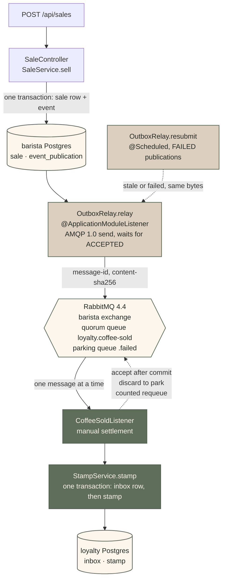

<p align="center">
  <a href="https://github.com/lukas-grigis/spring-outbox-inbox/actions/workflows/build.yml"></a>
  
  
  
  
  
</p>

<h1 align="center">Spring Boot Outbox and Inbox</h1>

<p align="center">
  A transactional outbox on the producer, an inbox on the consumer, RabbitMQ 4.4 over AMQP 1.0 in between.
  Every message is processed once although delivery stays at least once.<br>
  Shown by killing processes and the broker and dropping confirmations and settlements under load, next to three
  versions that lose, invent or double-apply messages.
</p>

<p align="center"><a href="https://lukasgrigis.dev/blog/spring-boot-outbox-inbox/"><strong>Read the companion blog post &rarr;</strong></a></p>

Three things this repo established against a live server, each pinned by a test:

- A listener that throws is **released** by Spring's default container, and since RabbitMQ 4.3 a release does not
  count toward the delivery limit. The delivery count stays 0 through every redelivery, past twice the queue's
  delivery limit, so a message that always fails loops forever (`ReleasedDoesNotCountIT`). Loyalty settles by hand
  with a counted requeue, and that path parks the message at the delivery limit (`ParkingIT`).
- A connection that dies with an unsettled delivery **does** count as a failed delivery (`LostSettlementIT`). That is
  why loyalty takes one message at a time: with a deeper prefetch, one lost connection would add a counted failure to
  every message in flight.
- A send the broker cannot route is not accepted. The publication fails, stays in the registry, and the resend carries
  the same message id, bytes and hash as the first attempt (`BrokerRefusesOutboxIT`).

---

## The problem

A coffee shop service records a sale and tells the loyalty service about it, so the customer's card gets one stamp per cup. Two systems, two commits, no transaction across them.
Every ordering of those two steps has a failure:

1. **Commit, then send.** A crash in between, or a send that fails after the commit (broker restart, dropped
   connection), and the sale exists, the message never does. Lost: a coffee paid for, no stamp.
2. **Send, then commit.** A crash or rollback after the send and the consumer holds a message for a sale that does not
   exist. A ghost: a stamp for a coffee nobody paid for.
3. **Deliver at least once.** The broker redelivers whenever a settlement is lost: a killed consumer, a dropped
   connection, a lost accept. The consumer stamps the same message twice. Double-applied.

The outbox closes the first two: the sale and the intent to send it commit in one local transaction, and a relay retries
until the broker accepts. The price is the third: a relay that cannot tell whether its send arrived will send again.
The inbox closes that one. The consumer records the message id in the same transaction as the effect, so a second
delivery finds the id and does nothing. Processed once, delivered at least once.

This repo builds both sides and measures them against three naive versions under the same load, the same seed and the
same faults.

## Architecture



One request, end to end, naming the class at each hop:

1. **`SaleController`** validates the request body and calls `SaleService.sell`.
2. **`SaleService.sell`** creates the `Sale` and the `CoffeeSold` event from it. One `switch` over `barista.mode` shows
   where the commit sits relative to the send. In `outbox` mode it saves the sale and publishes the event inside one
   transaction, and the Spring Modulith registry stores the event in `event_publication` in that same transaction. The
   two naive modes (`after-commit`, `in-transaction`) send directly and never touch the registry.
3. **`CoffeeSoldSender`** sends with `RabbitAmqpTemplate.convertAndSend`. Spring AMQP's `JacksonJsonMessageConverter`
   writes the JSON with Boot's `JsonMapper`, then a post-processor sets the message id and `content-sha256`, the
   SHA-256 of exactly the bytes Jackson wrote. The send completes when the broker answers ACCEPTED. A reject, a
   release, a lost connection or the 5 s send timeout fails it.
4. **`OutboxRelay.relay`** is an `@ApplicationModuleListener`. Modulith calls it after the commit and marks the
   publication completed only when the returned send completes, so a failed send leaves the publication FAILED.
   Modulith ships a RabbitMQ externalizer for AMQP 0.9.1 only, which is why the relay is this one method.
5. **`OutboxRelay.resubmit`** calls `FailedEventPublications.resubmit` every 5 seconds. Staleness settings turn a
   publication left half done by a crash into FAILED first. Modulith stores the event as JSON with the same
   `JsonMapper`, so a resend carries the same bytes and hash.
6. **RabbitMQ** routes `coffee.sold` from the `barista` exchange into the quorum queue `loyalty.coffee-sold`. Dead-letter
   target and delivery limit are a policy (`support/rabbitmq/definitions.json`), not queue arguments.
7. **`CoffeeSoldListener`** gets the `CoffeeSold` already converted, next to the raw AMQP message, and settles by hand.
   It checks the header hash against the raw body and the Bean Validation constraints on `CoffeeSold`, then calls
   `StampService.stamp`, and only afterwards settles: accept, a counted requeue when something threw, or a plain
   discard that the broker dead-letters to the parking queue. The reason goes to loyalty's log as
   `Message <id> parked: <VERDICT>`.
8. **`StampService.stamp`** runs in one transaction. `INSERT INTO inbox ... ON CONFLICT DO NOTHING` returns 1 the first
   time a message id is seen, and only then is the `Stamp` saved. A 0 means seen before: a second statement counts a
   duplicate when the content hash matches, and the message is parked as `ID_REUSED` when it doesn't.

Persistence is Spring Data JPA over Hibernate (`ddl-auto: validate`). Each app's schema is one Liquibase SQL file,
[`barista.sql`](barista/src/main/resources/db/barista.sql) and [`loyalty.sql`](loyalty/src/main/resources/db/loyalty.sql).
Modulith creates its own `event_publication` table. The inbox insert is a query, not a `save()`, because the insert
itself has to tell a new message from a seen one, also when two loyalty instances get the same id at the same moment
(the second waits for the first and gets 0). JPQL has no `INSERT`, so it's HQL, and Hibernate sends its
`ON CONFLICT DO NOTHING` to Postgres as written. The Modulith registry stays on JDBC and commits with the sale row
under the same `JpaTransactionManager`, and `RollbackOutboxIT` rolls `SaleService.sell` back and finds neither row.

The SHA-256 is computed once by the producer over the bytes Jackson wrote and travels as `content-sha256`. Loyalty
recomputes it on receipt and parks the message on a difference. The loyalty database and the measurement script
recompute it from the stored body. The `sale` table keeps the sale, not the message bytes, because Spring writes those
at send time. In outbox mode the `event_publication` row holds the same text, and `BrokerRefusesOutboxIT` checks
Postgres's `sha256()` of it against the header.

## Quick start

You need [Docker](https://docs.docker.com/get-docker/) and [mise](https://mise.jdx.dev/). mise provisions Java, Maven
and Python.

```bash
git clone https://github.com/lukas-grigis/spring-outbox-inbox.git
cd spring-outbox-inbox
mise run demo
```

`mise run demo` builds the modules, starts RabbitMQ, two Postgres databases and Toxiproxy, then runs a narrated story:
one sale and one kill, then four chaos scenarios with the same seed, and the comparison table.
The recorded run took 6 min 2 s. Infrastructure stays up afterwards.

| Port                                   | What's there                                |
| -------------------------------------- | ------------------------------------------- |
| `:8081`, `:8082`                       | barista instances                           |
| `:8091`, `:8092`                       | loyalty instances                           |
| `:5672`                                | RabbitMQ (AMQP 1.0), management on `:15672` |
| `:5432`                                | barista Postgres                            |
| `:5433`                                | loyalty Postgres                            |
| `:21001`, `:21002`, `:21011`, `:21012` | Toxiproxy proxies, one per app instance     |
| `127.0.0.1:8474`                       | Toxiproxy API                               |

Individual tasks:

```bash
mise run build                          # package all modules, tests skipped
mise run test                           # all tests (Testcontainers, no infra:up needed)
mise run infra:up                       # RabbitMQ, two Postgres databases, Toxiproxy
mise run scenario -- outbox+inbox       # one scenario; also --seed N
mise run infra:down                     # stop and drop the volumes
```

`mise run scenario` takes `after-commit+naive`, `in-transaction+naive`, `outbox+naive` or `outbox+inbox`,
and starts the infrastructure itself when it is down. With the default seed 42 it overwrites the committed
`results/<scenario>.json`: the six cells, the gates, the chaos schedule as it ran, and a timeline that counts
sales, stamps and each kind of failure per second since the load began. Every run rewrites `results/SUMMARY.md`
and the tables below.

## The measured comparison

Four scenarios, each 2000 sale requests at 40 per second, seed 42, against two barista and two loyalty instances. During every
run the harness kills instances with `kill -9`, kills and restarts the broker, drops the broker's confirms to the
producer and loyalty's settlements to the broker for 6 seconds at a time, and lets each app halt itself at a crash
point (`halt(137)`, no shutdown hooks). A drain phase then waits for the queue to empty. The recorded output of that run is
in [`results/`](results/), the table is [`results/SUMMARY.md`](results/SUMMARY.md). `results/` also holds two separate
seed runs of the last row (43 and 44).

<!-- results:start -->

| scenario             | committed | lost | ghosts | double-applied | duplicates delivered | hash mismatch | gates |
| -------------------- | --------- | ---- | ------ | -------------- | -------------------- | ------------- | ----- |
| after-commit+naive   | 1316      | 274  | 0      | 2              | 2                    | 0             | ok    |
| in-transaction+naive | 1049      | 0    | 25     | 2              | 2                    | 0             | ok    |
| outbox+naive         | 1412      | 0    | 0      | 25             | 25                   | 0             | ok    |
| outbox+inbox         | 1415      | 0    | 0      | 0              | 25                   | 0             | ok    |

Seeds of the last row, same load and chaos recipe (n = 3). Seed 42 is the last row of the table above, the others come from `mise run scenario -- outbox+inbox --seed N`. The seed fixes the chaos schedule and the crash draws, not the timing, so the duplicate counts differ.

| seed | committed | lost | ghosts | double-applied | duplicates delivered | hash mismatch | gates |
| ---- | --------- | ---- | ------ | -------------- | -------------------- | ------------- | ----- |
| 42   | 1415      | 0    | 0      | 0              | 25                   | 0             | ok    |
| 43   | 1107      | 0    | 0      | 0              | 9                    | 0             | ok    |
| 44   | 1691      | 0    | 0      | 0              | 29                   | 0             | ok    |

<!-- results:end -->

- `committed`: sales that reached the database. The cells compare rows with different bases: each request is sent
  once, so one that reaches a killed instance, or that the in-transaction version rolls back, leaves no sale.
- `lost`: a committed sale with no stamp. A crash-point halt is one way to get there, a send that failed after the
  commit (broker restart, connection recovery) or a `kill -9` between commit and send are the others.
- `ghosts`: a stamp for a sale that was never committed.
- `double-applied`: a message id with more than one stamp row.
- `duplicates delivered`: deliveries of a message id loyalty had already received. In the naive rows nothing counts
  them, so the figure is read from the database as the surplus stamp rows. In the inbox row it is `sum(inbox.duplicates)`,
  a sum loyalty writes itself, in the transaction that decides not to stamp. The independent evidence that none of them
  was stamped is `double-applied` = 0 and the cups sold matching the stamps in loyalty-db.
- `hash mismatch`: a message whose SHA-256 disagrees between any two of the four computations, or that loyalty
  parked as `HASH_MISMATCH` because the producer's header disagreed with its own. The four are the producer's over the
  bytes Jackson wrote (the `content-sha256` header), loyalty's on receipt (stored with the stamp), Postgres's
  `sha256()` over the stored body, and Python's `hashlib` over the same body.

The inbox row is not a lucky outcome. The run only counts as valid if it provoked what it claims to cure: the demo
exits 1 unless the naive rows show their failure, every eligible crash point fired, the inbox row suppressed more than
zero duplicates, and some duplicates came from the broker redelivering (a delivery count of 1 or more) and not only from the
producer sending again. Every chaos action must also have run without error, and a `kill -9` that finds its instance
already down is reported as skipped. The queue must drain within 120 seconds, the inbox row must read 0 for lost,
ghosts, double-applied and hash mismatch with an empty parking queue, and its cups sold must equal the stamps in
loyalty-db.

This is an internal measurement on one machine. The counts come from one run each. A rerun with the same seed gives
different numbers in the non-zero cells (the seed fixes the schedule, not the timing), so read those as the size of the
effect, not as constants. What the run claims is the zero cells of the last row: under these faults, none of them showed
up. It does not show that no other fault does.

## What the tests pin down

Twenty tests: unit tests for the contract, and integration tests against a real RabbitMQ 4.4.1 and a real Postgres 18
started by Testcontainers. Three pairs give the same input to two versions, so cause and effect sit side by side.
Docker is required even for `mise run test`.

| Finding                                                                                                                                                                                                 | Test                                                                                                                      |
| ------------------------------------------------------------------------------------------------------------------------------------------------------------------------------------------------------- | ------------------------------------------------------------------------------------------------------------------------- |
| A rolled-back sale in outbox mode leaves neither the sale nor its publication                                                                                                                           | [`RollbackOutboxIT`](barista/src/test/java/dev/lukasgrigis/outboxinbox/barista/RollbackOutboxIT.java)                     |
| The same rollback in in-transaction mode leaves a message on the queue without a sale                                                                                                                   | [`RollbackInTransactionIT`](barista/src/test/java/dev/lukasgrigis/outboxinbox/barista/RollbackInTransactionIT.java)       |
| A send the broker refuses fails the publication; once the broker accepts, the resubmission sends the same id, bytes and hash, and Postgres's `sha256()` of the stored publication equals the header     | [`BrokerRefusesOutboxIT`](barista/src/test/java/dev/lukasgrigis/outboxinbox/barista/BrokerRefusesOutboxIT.java)           |
| The same refusal in after-commit mode loses the message, and nothing sends it again                                                                                                                     | [`BrokerRefusesAfterCommitIT`](barista/src/test/java/dev/lukasgrigis/outboxinbox/barista/BrokerRefusesAfterCommitIT.java) |
| The same message delivered twice is stamped once and counted as one duplicate; Postgres's `sha256()` of the stored body equals loyalty's hash                                                           | [`DeliveredTwiceInboxIT`](loyalty/src/test/java/dev/lukasgrigis/outboxinbox/loyalty/DeliveredTwiceInboxIT.java)           |
| Without the inbox, the same message delivered twice is stamped twice                                                                                                                                    | [`DeliveredTwiceNaiveIT`](loyalty/src/test/java/dev/lukasgrigis/outboxinbox/loyalty/DeliveredTwiceNaiveIT.java)           |
| A listener that always throws is released, not counted: it is redelivered past the delivery limit with the count at 0                                                                                   | [`ReleasedDoesNotCountIT`](loyalty/src/test/java/dev/lukasgrigis/outboxinbox/loyalty/ReleasedDoesNotCountIT.java)         |
| A failure that keeps happening, settled with a counted requeue, parks at the delivery limit and leaves no inbox row                                                                                     | [`ParkingIT`](loyalty/src/test/java/dev/lukasgrigis/outboxinbox/loyalty/ParkingIT.java)                                   |
| A body that doesn't match its hash, breaks a constraint, reuses an id for different content or isn't JSON is parked without effect, and after the one that isn't JSON the next message is still stamped | [`ParkingIT`](loyalty/src/test/java/dev/lukasgrigis/outboxinbox/loyalty/ParkingIT.java)                                   |
| A lost settlement makes the broker redeliver, the dead connection counts as a failed delivery, and the inbox suppresses the duplicate                                                                   | [`LostSettlementIT`](loyalty/src/test/java/dev/lukasgrigis/outboxinbox/loyalty/LostSettlementIT.java)                     |
| The listener container takes one message at a time                                                                                                                                                      | [`LostSettlementIT`](loyalty/src/test/java/dev/lukasgrigis/outboxinbox/loyalty/LostSettlementIT.java)                     |
| The application's converter writes the same bytes as the contract's                                                                                                                                     | [`MessageConverterIT`](barista/src/test/java/dev/lukasgrigis/outboxinbox/barista/MessageConverterIT.java)                 |
| The wire format is pinned byte for byte by a golden fixture and its SHA-256, with a non-ASCII card id, and hostile Unicode survives the round trip                                                      | [`CoffeeSoldContractTest`](messaging/src/test/java/dev/lukasgrigis/outboxinbox/messaging/CoffeeSoldContractTest.java)     |
| The queues are quorum queues and leave dead-lettering and the delivery limit to the broker policy                                                                                                       | [`CoffeeSoldTopologyTest`](messaging/src/test/java/dev/lukasgrigis/outboxinbox/messaging/CoffeeSoldTopologyTest.java)     |

## Project structure

```
├── messaging/   the contract: CoffeeSold with its constraints, ContentHash, queue topology
├── barista/     producer: web, service (SaleService, three modes), persistence (Sale), messaging (sender, outbox relay), chaos
├── loyalty/     consumer: messaging (CoffeeSoldListener), service (StampService, Verdict), persistence (inbox, stamp), chaos
├── support/     compose.yaml, RabbitMQ policy, Toxiproxy proxies, chaos.py (the chaos run and its measurement)
└── results/     the recorded run: one JSON per scenario, SUMMARY.md, demo.txt
```

Java package root `dev.lukasgrigis.outboxinbox`, with `messaging`, `barista` and `loyalty` below it. Inside each app
the packages are layers: `web` calls `service`, `service` uses `persistence` and `messaging`, and `chaos` holds the
crash points the chaos run fires.

`barista` and `loyalty` depend on `messaging` and never on each other. Both serialize with Spring AMQP's
`JacksonJsonMessageConverter` over Boot's `JsonMapper`. `CoffeeSoldContractTest` pins the bytes, and
`MessageConverterIT` holds the application's converter to them.

## Tech stack

| Layer       | What's running                                                                                                        |
| ----------- | --------------------------------------------------------------------------------------------------------------------- |
| App         | Spring Boot 4.2.0, Spring Modulith 2.2.0, Spring AMQP 4.2.0 (`spring-boot-starter-amqp-rabbitmq`), Lombok             |
| Messaging   | RabbitMQ 4.4.1 (`rabbitmq:4.4.1-management`), AMQP 1.0, quorum queue                                                  |
| Database    | PostgreSQL 18 (`postgres:18-trixie`), one database per service                                                        |
| Persistence | Spring Data JPA with Hibernate 7.4; Modulith's event registry stays on JDBC                                           |
| Migrations  | Liquibase 5.0.4, one SQL changelog per app (`ddl-auto: validate`); Modulith creates its own `event_publication` table |
| Faults      | Toxiproxy 2.13.0, `kill -9`, `docker compose kill`, in-process `halt(137)`                                            |
| Tests       | Testcontainers 2.0.5 with `@ServiceConnection`, against real RabbitMQ and Postgres                                    |
| Tooling     | mise (Java 25, Maven 3.9.12, Python 3.14); `support/chaos.py` uses the standard library only                          |

## Limits

Where this approach ends:

- This is Spring Modulith's event publication registry used as an outbox, with a listener as the relay. The Modulith
  reference calls that "a pragmatic, simple solution" that "lacks critical features developers might expect from actual
  outbox pattern implementations", and since 2.1 it points to Namastack Outbox and JobRunr for those.
- Processed once holds for effects inside loyalty's Postgres transaction. A call to another system, an email, a
  second broker is outside it, and the inbox can't make those idempotent for you.
- There is no ordering guarantee. A failed publication that is resubmitted goes out after later ones. Stamps add up, so
  order doesn't matter here. For state that gets overwritten it would.
- The inbox is never purged. Purging needs a retention longer than the longest time a message can still be redelivered
  or resent, or a deleted id is applied a second time. The NServiceBus outbox docs state the same rule.
- A publication that can never be sent, for example a payload a newer version can't deserialize, is resubmitted every
  5 seconds forever and logged each time. Nothing alerts on it.
- One RabbitMQ node. Nothing here shows what a cluster partition does.
- No Postgres faults are injected. The runs kill apps and the broker and drop confirmations and settlements, not the
  databases.
- There is no pause when loyalty's database is down. An outage turns each delivery into a counted requeue, and the
  message parks after the delivery limit of 20 instead of waiting for the database.
- A parked message carries only the broker's reason (`x-last-death-reason`: `rejected` or `delivery_limit`), not
  loyalty's verdict. Loyalty logs that (`Message <id> parked: <VERDICT>`), and a body that isn't JSON never reaches the
  listener: Spring logs it as a "Fatal message conversion error".
- A publisher whose connection recovery failed keeps throwing `AmqpResourceClosedException` until the app restarts, and
  the relay doesn't log that case apart from other send failures. This is read from the library's bytecode and was not
  reproduced against a live broker.
- The hash is an unkeyed SHA-256. It shows integrity against accidents (a truncated or re-encoded body), not
  authenticity: anyone who can alter the body can alter the hash.
- One message at a time costs throughput. Each loyalty instance holds one unsettled delivery at a time, so the
  scenarios run two instances at 40 sales per second.
- This is an internal measurement on one machine, with one seed per row in the main table and three seeds for the last
  row. It is not a benchmark.

## Contributing

If you find a bug or have an idea, open an issue or send a pull request.

1. Fork the repo
2. Create a branch (`git checkout -b my-change`)
3. Make your changes
4. Run `mise run test` to make sure things work
5. Open a PR

## License

[MIT](LICENSE)
